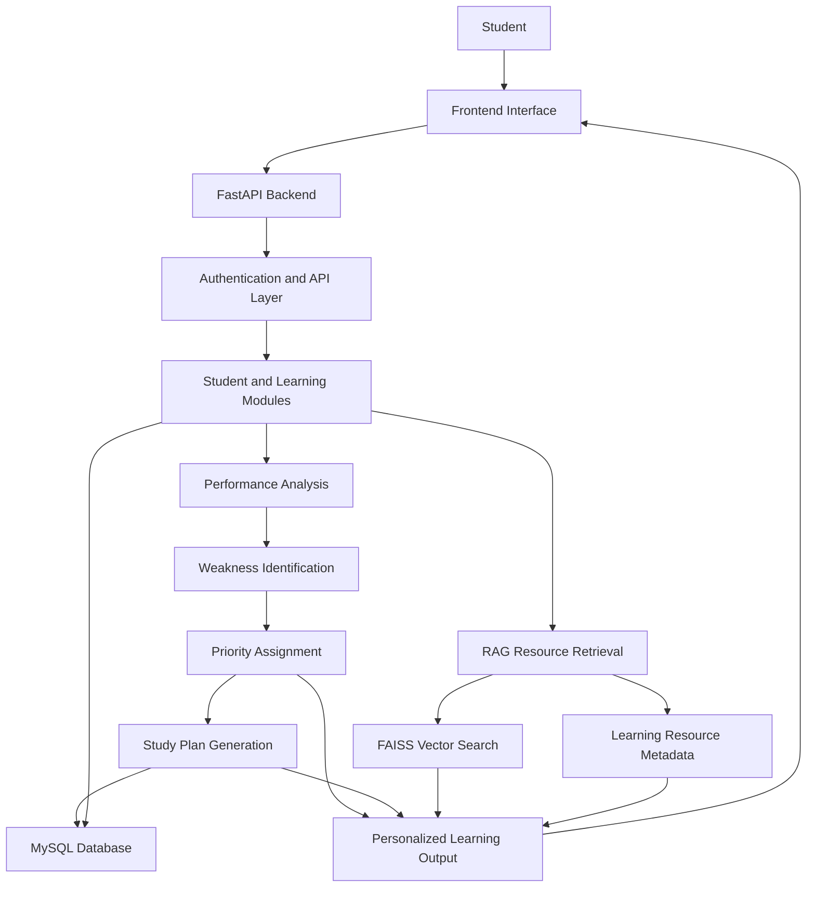

# 🎓 AI Personalized Learning Planner

<p align="center">
  <strong>Learn Smarter. Identify Weaknesses. Build Better Study Habits.</strong>
</p>

<p align="center">
  An AI-powered learning platform that analyzes student performance, identifies knowledge gaps, and helps create personalized study plans.
</p>

<p align="center">
  
  
  
  
  
</p>

---

## 📌 Overview

The **AI Personalized Learning Planner** is an intelligent learning management application designed to make studying more structured, focused, and data-driven.

Traditional study schedules often follow a fixed approach without considering a student's understanding of individual topics. This project addresses that limitation by analyzing topic-wise performance, identifying strengths and weaknesses, and prioritizing areas that require improvement.

The application combines performance analysis, personalized study planning, database management, and AI-based learning resource retrieval to support a more organized learning experience.

## ✨ Key Features

- **Student Authentication:** Secure student sign-in and account management
- **Student Profiles:** Maintain student information and learning details
- **Subject Management:** Organize academic subjects
- **Topic Management:** Structure subjects into individual learning topics
- **Performance Tracking:** Record and monitor topic-wise assessment scores
- **Weakness Identification:** Identify topics that require additional attention
- **Priority-Based Learning:** Assign learning priorities based on student performance
- **Personalized Study Plans:** Generate structured study plans according to learning needs
- **AI-Based Resource Retrieval:** Retrieve relevant learning materials using a RAG-based approach
- **REST API:** Handle application operations through FastAPI endpoints
- **Database Management:** Store student information, subjects, topics, performance records, and study plans using MySQL

## 🧠 How It Works

The application follows a performance-driven learning workflow.

1. **Student Input:** Student profiles, subjects, topics, and performance records are maintained in the application.
2. **Performance Analysis:** Topic-wise assessment scores are analyzed to understand learning progress.
3. **Weakness Identification:** Topics with lower performance are identified for additional attention.
4. **Priority Assignment:** Learning priorities are assigned based on the student's performance.
5. **Study Plan Generation:** A structured study plan is created to organize learning activities.
6. **Resource Retrieval:** Relevant learning resources can be retrieved through the RAG-based retrieval component.
7. **Progress Tracking:** Updated performance records provide information for subsequent learning-plan improvements.

## 🏗️ System Architecture

The application follows a modular architecture that connects the frontend, backend, database, performance analysis, and AI-based resource retrieval components.



## 🛠️ Technology Stack

| Category | Technologies |
|---|---|
| Programming Language | Python 3.12 |
| Backend Framework | FastAPI |
| Database | MySQL 8.0 |
| AI / Information Retrieval | Retrieval-Augmented Generation (RAG), FAISS |
| Frontend | HTML, CSS, JavaScript |
| Additional Interface | Streamlit |
| API Documentation | FastAPI Swagger UI |
| Database Connectivity | PyMySQL |
| Version Control | Git and GitHub |
| Development Environment | Visual Studio Code |

## 📂 Project Structure

```text
ai-personalized-learning-planner/
│
├── app/
│   ├── agents/
│   ├── api/
│   ├── database/
│   ├── rag/
│   ├── schemas/
│   ├── tools/
│   └── workflows/
│
├── frontend/
│
├── streamlit/
│
├── data/
│   └── curriculum_coverage_report.json
│
├── migrations/
│
├── tests/
│
├── backups/
│
├── .env.example
├── .gitignore
├── requirements.txt
└── README.md
```

*This is a simplified representation of the project structure. Local configuration files, generated vector indexes, temporary backups, and environment-specific files are excluded where appropriate.*

## ⚙️ Installation and Setup

### Prerequisites

Install the following before running the project:

- Python 3.12
- MySQL Server 8.0 or later
- Git
- Visual Studio Code (recommended)

### 1. Clone the Repository

```powershell
git clone https://github.com/SPOORTHISV6/ai-personalized-learning-planner.git

cd ai-personalized-learning-planner
```

### 2. Create a Virtual Environment

```powershell
py -3.12 -m venv .venv

.venv\Scripts\Activate.ps1
```

### 3. Install Dependencies

```powershell
python -m pip install --upgrade pip

pip install -r requirements.txt
```

### 4. Configure Environment Variables

Create a local `.env` file from the example configuration:

```powershell
Copy-Item .env.example .env
```

Update the required database credentials and application settings in `.env`.

**Security note:** Never upload actual environment files, passwords, API keys, or authentication tokens to GitHub.

### 5. Configure the MySQL Database

Start your MySQL server and create the application database:

```sql
CREATE DATABASE ai_learning_planner;
```

Configure the database connection using the environment variables specified in `.env`.

Apply the project's database migrations before starting the application.

### 6. Run the Application

Start the FastAPI server using the correct application entry point configured in the project.

Example, if the entry point is `app/main.py`:

```powershell
uvicorn app.main:app --reload
```

The application API documentation can then be accessed at:

```text
http://127.0.0.1:8000/docs
```

*The example Uvicorn command assumes that `app/main.py` exposes a FastAPI instance named `app`. Verify the actual entry point before running it.*

## 🗄️ Database Management and Recovery

The application uses MySQL to manage structured learning information.

The database includes information related to:

- Student profiles
- Subjects
- Topics
- Performance records
- Personalized study plans
- Study-plan items and related learning data

Database backup and recovery validation have also been performed.

The restoration validation checked:

- Database table structures
- Restored table record counts
- Foreign-key relationships
- Successful restoration into a separate test database

These checks help verify database consistency and recovery reliability.

## 🔍 AI-Based Learning Resource Retrieval

The project includes a Retrieval-Augmented Generation (RAG) component for retrieving learning resources relevant to a student's learning topics.

The retrieval workflow uses:

- **FAISS:** Vector similarity search for retrieving relevant content
- **Vector Indexes:** Topic-specific indexes for organizing learning information
- **Metadata:** Associated information for retrieved content

The objective is to connect relevant learning materials with the student's personalized study workflow.

## 🔐 Security and Reliability

The project incorporates development practices to improve application security and reliability:

- Environment-based configuration for sensitive settings
- Authentication and protected application operations
- Separation of application and testing database configurations
- Database backup and restoration validation
- Automated tests for important application components
- Git ignore rules for local environments, credentials, and generated files

## 🚀 Future Enhancements

The following improvements can extend the project:

- Adaptive study scheduling based on learning progress
- Detailed learning analytics and performance visualizations
- Improved learning resource recommendation strategies
- Automated student progress summaries
- Expanded assessment and feedback mechanisms
- Enhanced personalization based on individual learning patterns

## 🎯 Project Objective

The objective of this project is to develop a practical AI-assisted learning platform that moves beyond fixed study schedules.

By combining student performance analysis, topic prioritization, structured study planning, and AI-based resource retrieval, the application aims to make learning more organized, focused, and personalized.

## 👩‍💻 Developer

**Spoorthi S V**

Artificial Intelligence and Machine Learning

Bapuji Institute of Engineering and Technology

[GitHub Profile](https://github.com/SPOORTHISV6)

[Project Repository](https://github.com/SPOORTHISV6/ai-personalized-learning-planner)

---

<p align="center">
  <strong>Built with Python, AI, and a focus on smarter learning. 📚</strong>
</p>
