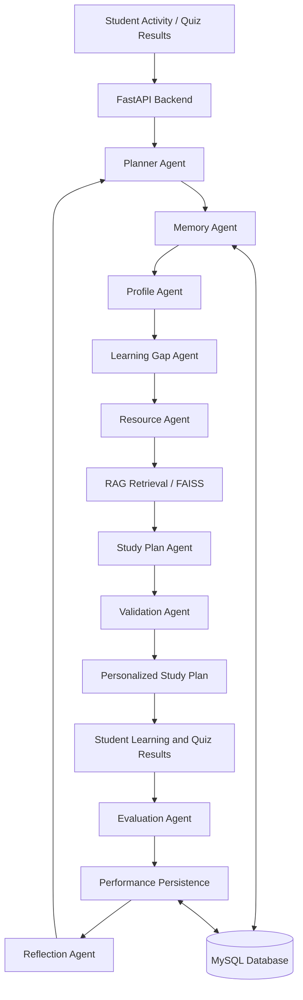

# 🎓 AI Personalized Learning & Study Planner


### Turning student performance into personalized learning paths with Agentic AI and RAG

<p align="center">
  
  
  
  
  
  
</p>

<p align="center">
  <b>An AI-powered learning system that identifies knowledge gaps, evaluates student performance, retrieves relevant learning resources, and generates personalized study plans.</b>
</p>

<p align="center">
  <a href="https://github.com/SPOORTHISV6/ai-personalized-learning-planner">Repository</a> •
  <a href="https://github.com/SPOORTHISV6/ai-personalized-learning-planner/blob/main/AI%20Personalized%20Learning%20Planner%20-%20ReDoc.pdf">API Documentation</a> •
  <a href="#-getting-started">Get Started</a>
</p>

---

## 📌 Overview

Every student learns differently, yet traditional study plans often follow the same structure regardless of individual performance.

**AI Personalized Learning & Study Planner** addresses this challenge by combining an agent-based workflow, student performance analysis, persistent learning history, and Retrieval-Augmented Generation (RAG).

The system evaluates a student's progress, identifies weak topics, retrieves relevant educational material, and creates a structured study plan. After a quiz or evaluation, performance records can inform subsequent learning decisions.

The goal is simple: **help students focus on what they need to learn next, rather than treating every topic equally.**

## ✨ Key Features

| Feature | Description |
|---|---|
| 🧠 Adaptive Learning | Uses student performance and learning history to guide learning priorities. |
| 🎯 Learning Gap Analysis | Classifies topics by performance and identifies areas needing attention. |
| 📅 Personalized Study Planning | Generates study sessions based on identified learning needs. |
| 📊 Performance Evaluation | Evaluates quiz scores and persists performance records. |
| 🔄 Reflection Workflow | Uses weak performance to trigger further learning and planning steps. |
| 🗂️ Student Memory | Maintains relevant student profile, performance, and learning history. |
| 📚 RAG-Based Resource Retrieval | Retrieves relevant content from indexed curriculum documents. |
| 🔌 REST API | Exposes endpoints for student management, quizzes, resources, performance, and study plans. |
| 🛡️ Plan Validation | Checks generated study plans before accepting them. |
| 🧪 Automated Testing | Includes tests for agents, workflows, API routes, persistence, and database integration. |


## 🏗️ System Architecture




### 🔍 Workflow Explanation

1. **Profile and memory:** Load the relevant student profile and learning history.
2. **Learning gap analysis:** Analyze performance records to identify weak and stronger topics.
3. **Resource retrieval:** Search the curriculum knowledge base for relevant learning material.
4. **Study plan generation:** Create study sessions based on learning priorities.
5. **Validation:** Check the generated plan before returning it.
6. **Evaluation:** Process quiz performance and persist evaluation results.
7. **Reflection and adaptation:** Use weak performance to guide subsequent learning workflow execution.

*The diagram represents the intended high-level workflow; exact execution order and routing depend on the implementation.*

## 🛠️ Technology Stack

| Category | Technologies |
|---|---|
| Programming Language | Python |
| Backend Framework | FastAPI |
| Database | MySQL |
| Database Access | SQLAlchemy, PyMySQL |
| Data Validation | Pydantic |
| Vector Search | FAISS |
| Embeddings | Sentence Transformers |
| AI Architecture | Specialized agents, adaptive workflows, RAG |
| API Documentation | FastAPI interactive API documentation |
| Testing | pytest |
| Development Tools | Git, GitHub, VS Code |

## 📂 Project Structure

```text
ai-personalized-learning-planner/
│
├── app/
│   ├── agents/
│   │   ├── planner_agent.py
│   │   ├── profile_agent.py
│   │   ├── memory_agent.py
│   │   ├── learning_gap_agent.py
│   │   ├── resource_agent.py
│   │   ├── study_plan_agent.py
│   │   ├── evaluation_agent.py
│   │   ├── reflection_agent.py
│   │   └── validation_agent.py
│   │
│   ├── api/                 # REST API routes
│   ├── core/                # Security and core configuration
│   ├── database/            # Models, connection, and seed data
│   ├── memory/              # Student memory management
│   ├── rag/                 # Document retrieval and vector stores
│   ├── schemas/             # Pydantic schemas
│   ├── tools/               # Learning tools
│   ├── validation/          # Study plan validation
│   ├── workflows/           # Learning and evaluation workflows
│   └── main.py              # FastAPI application entry point
│
├── data/
│   ├── documents/           # Educational curriculum PDFs
│   ├── extraction_reports/  # Document extraction reports
│   └── vector_store/        # FAISS indexes and metadata
│
├── frontend/                # Application interface
├── migrations/              # SQL schema migrations
├── tests/                   # Automated tests
├── requirements.txt
└── README.md
```

## ⚙️ Getting Started

### Prerequisites

Install the following before running the project:

- Python 3.12
- MySQL Community Server
- Git
- A working internet connection for installing dependencies and downloading any required embedding models

### 1. Clone the repository

```bash
git clone https://github.com/SPOORTHISV6/ai-personalized-learning-planner.git
cd ai-personalized-learning-planner
```

### 2. Create and activate a virtual environment

**Windows PowerShell**

```powershell
py -3.12 -m venv .venv
.\.venv\Scripts\Activate.ps1
```

### 3. Install dependencies

```powershell
python -m pip install --upgrade pip
pip install -r requirements.txt
```

### 4. Configure the database

Create the development database in MySQL:

```sql
CREATE DATABASE ai_learning_planner;
```

Configure the database connection using the environment variables or local configuration expected by the application.

**Security note:** Never commit database passwords, secret keys, access tokens, or `.env` files to GitHub.

Review the migration scripts in `migrations/` and apply only migrations that have not already been applied to the database.

### 5. Start the FastAPI server

From the project root:

```powershell
python -m uvicorn app.main:app --reload
```

If the application starts successfully, open:

- **Interactive API docs:** http://127.0.0.1:8000/docs
- **Alternative API docs:** http://127.0.0.1:8000/redoc

### 6. Build or verify the RAG indexes

The repository contains curriculum PDFs, FAISS indexes, and associated metadata. If you modify the curriculum documents or need to rebuild the indexes, inspect the existing indexing scripts under `app/rag/` and `app/workflows/` and run the appropriate workflow.

Keep each index and its metadata synchronized.

## 🧪 Testing

Run the automated test suite from the project root:

```powershell
python -m pytest -q
```

### MySQL integration tests

Integration tests require the separate `ai_learning_planner_test` database. The test infrastructure checks the database name to reduce the risk of accidentally modifying development data.

Configure the test database and its connection settings as required by `tests/integration/test_database.py`.

Enable the integration-test guard in PowerShell:

```powershell
$env:ALLOW_MYSQL_INTEGRATION_TESTS = "1"
```

Then run the integration tests:

```powershell
python -m pytest tests/integration -v
```

**Important:** Never point integration tests at your development database.

## 🔐 Engineering and Reliability

The project includes engineering safeguards beyond the core learning workflow:

- Input validation for performance scores.
- Persistence of quiz evaluation results.
- Database constraints to prevent duplicate performance records linked to the same quiz result.
- Handling of duplicate-key conflicts during evaluation persistence.
- Study plan validation.
- Automated tests for agent behavior, workflow routing, API endpoints, and database integration.

These safeguards help make the learning workflow more predictable and easier to maintain.

## 🚀 Future Enhancements

Potential next steps for the project include:

- [ ] Student dashboard with progress visualizations.
- [ ] Improved learning-resource relevance evaluation.
- [ ] More detailed explanations for recommended learning paths.
- [ ] Study reminders and calendar integration.
- [ ] Deployment with secure production database configuration.
- [ ] CI pipeline for automated testing on every push.
- [ ] Expanded evaluation datasets and measurable retrieval-quality benchmarks.

These are planned enhancements, not claims that the features are already implemented.

## 📖 Documentation

- [Source Code](https://github.com/SPOORTHISV6/ai-personalized-learning-planner)
- [API Documentation PDF](https://github.com/SPOORTHISV6/ai-personalized-learning-planner/blob/main/AI%20Personalized%20Learning%20Planner%20-%20ReDoc.pdf)
- [Automated Tests](https://github.com/SPOORTHISV6/ai-personalized-learning-planner/tree/main/tests)
- [Database Migrations](https://github.com/SPOORTHISV6/ai-personalized-learning-planner/tree/main/migrations)

## 👩‍💻 Author

**Spoorthi S. V.**

B.E. Artificial Intelligence and Machine Learning

Interested in AI/ML engineering, intelligent applications, and practical applications of agentic AI.

GitHub: [@SPOORTHISV6](https://github.com/SPOORTHISV6)

---

<p align="center">
  <b>Building more personalized ways to learn, one workflow at a time. 🚀</b>
</p>
